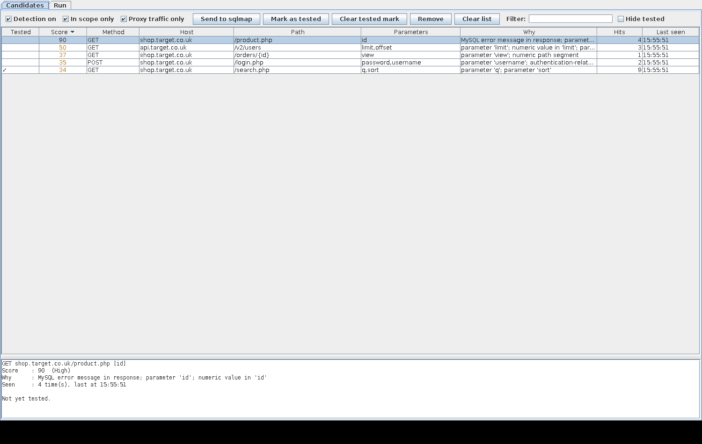
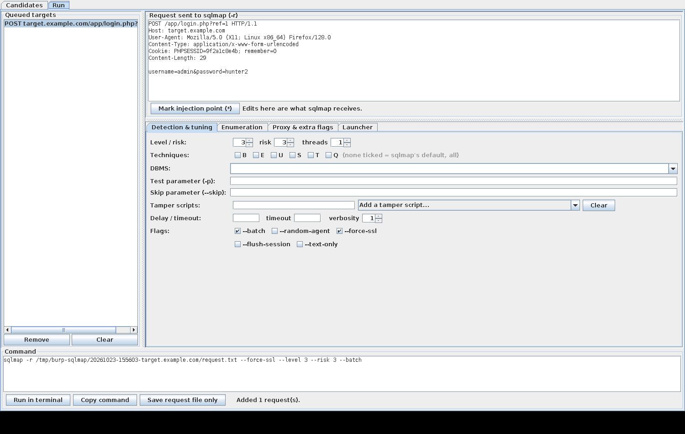
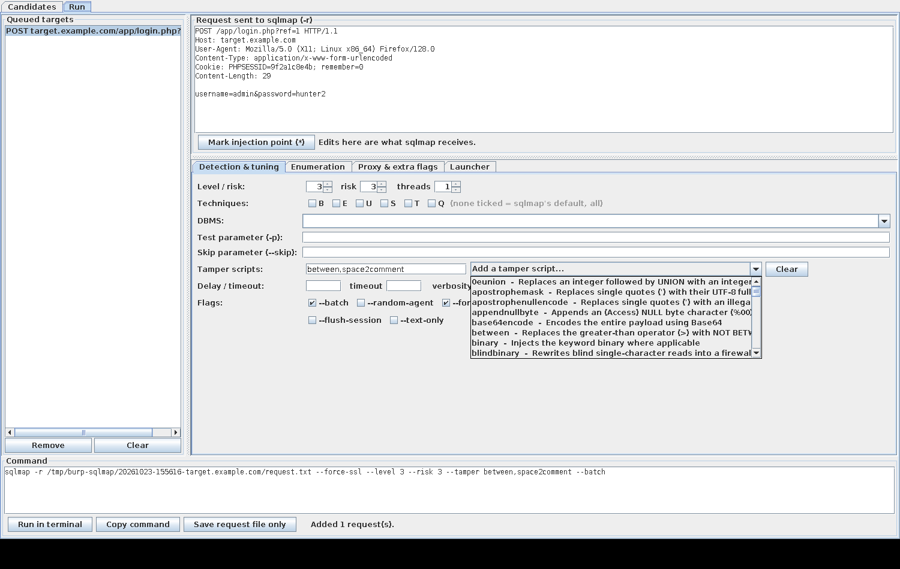

# sqlmap Launcher — a Burp Suite extension

Find the requests worth testing for SQL injection, hand them to **sqlmap in a
real terminal**, and keep track of what you have already tested.

Built on the Montoya API, so it loads straight into current Burp Suite with no
Jython involved.



---

## Why

Running sqlmap from a pentest usually means: find an interesting request, copy it
out of Burp, save it to a file, remember the flags, and keep a mental note of
what you already tried. This does all four, without leaving Burp, and without
reconstructing the request by hand.

## What it does

The extension adds a **sqlmap** tab with two panes: **Candidates** (what is worth
testing) and **Run** (testing it).

### Candidates — find the endpoints worth testing

A passive detector scores every request passing through Burp. It never sends a
request of its own; it only reads what Burp already saw. Scoring looks at:

- **DBMS error messages in the response** — MySQL, PostgreSQL, MSSQL, Oracle,
  SQLite, DB2 and Sybase signatures. The strongest signal there is, and worth 60
  points on its own, because it is evidence rather than inference.
- **Parameter names** that usually reach a `WHERE` clause (`id`, `cat`, `sort`,
  `filter`, `order_by`, and ~60 more).
- **Numeric parameter values**, and numeric path segments like `/orders/4821`.
- **Authentication paths** with body parameters.

Static assets and parameterless pages are dropped, unless they leak a SQL error
anyway. Off-scope and non-proxy traffic are filtered out by default, and sqlmap's
own User-Agent is ignored, so pointing sqlmap's `--proxy` back at Burp cannot
feed its traffic into the list.

Results are **deduplicated by endpoint**, not by request, so a hundred hits on
`/product.php?id=...` are one row with a hit count.

### Tested tracking — no duplicated testing

Every run is recorded against the endpoint it tested, with the flags it used.
Already-tested endpoints show a tick in the Candidates table and in the run
queue, and the detail pane lists each previous run with its flags and timestamp.

Hit Run on something already tested **with exactly the same flags** and it asks
first. Different flags go through without a prompt — testing harder than last
time is usually the point.

An endpoint's identity is `method + host + normalised path + parameter names`:

| | |
|---|---|
| `/orders/41` vs `/orders/42` | **Same** endpoint. Numeric, UUID and long-hex path segments collapse, so you are not re-testing per database row. |
| `/search?q=x` vs `/search?q=x&sort=y` | **Different** endpoints. A new parameter is new attack surface, so it comes up as untested. |
| Cookies | **Not** part of the identity. Analytics cookies come and go and would split one endpoint into a dozen keys. Still shown, and sqlmap still tests them at `--level 2+`. |

The record lives in Burp's **project file**, so it follows the engagement rather
than the machine, and survives a restart. *Mark as tested* covers runs you did
outside the extension.

### Run — hand it to sqlmap



1. **Right-click → Send to sqlmap**, or select rows in Candidates and send them.
   Works in Proxy history, Repeater, Target, Logger — anywhere Burp offers a
   context menu. Multiple selected requests queue up.
2. **The raw request is passed with `-r`** — headers, cookies, body, method and
   content type reach sqlmap exactly as Burp captured them. Nothing is
   reconstructed or re-encoded, so multipart, JSON and odd encodings all survive.
3. **Flags are built in the GUI.** The exact command is shown before anything
   runs. Level and risk both default to 3.
4. **Run opens a terminal.** sqlmap stays interactive, so it can still ask you
   questions, and you keep its normal output and progress display.

Each run gets its own directory (default `/tmp/burp-sqlmap/<timestamp>-<host>/`)
holding `request.txt`, the generated `run.sh` and whatever sqlmap writes.

---

## Requirements

| | |
|---|---|
| **Burp Suite** | Community or Professional. The extension uses the Montoya API, so a current release. |
| **A JDK, 17 or newer** | To build. A **JRE is not enough** — Gradle needs a compiler. |
| **sqlmap** | On your `PATH`, or point at it on the *Launcher* tab. |
| **OS** | Linux or macOS. Launching a terminal assumes a POSIX shell; Windows is untested. |

Gradle itself does not need installing — the wrapper (`./gradlew`) fetches it.

**Architecture does not matter.** The extension compiles to ordinary Java
bytecode, so one jar runs on amd64, arm64 and Apple Silicon alike. There is no
per-architecture build to choose between.

### Installing a JDK

```sh
sudo apt install default-jdk            # Debian, Kali, Ubuntu
sudo dnf install java-21-openjdk-devel  # Fedora, RHEL
sudo pacman -S jdk-openjdk              # Arch
brew install openjdk@21                 # macOS
```

Check it worked — this must print a version, not "command not found":

```sh
javac -version
```

## Install

**Build it:**

```sh
./build.sh
```

`build.sh` locates a JDK for you whatever your distribution calls it, then runs
Gradle. If you already have `javac` on your `PATH` or `JAVA_HOME` set, plain
`./gradlew build` does the same thing.

The extension lands at `build/burp-sqlmap-launcher.jar`.

> **If `./gradlew` fails with** *"does not provide the required capabilities:
> [JAVA_COMPILER]"* **or** *"JAVA_HOME is set to an invalid directory"*, Gradle
> is running on a JRE or on a path that does not exist. Use `./build.sh`, or set
> `JAVA_HOME` yourself to a directory containing `bin/javac`.
>
> Do not copy a `JAVA_HOME` path out of documentation. The directory name varies
> by distribution *and* by architecture — `java-21-openjdk-amd64` on x86_64,
> `java-21-openjdk-arm64` on ARM — so a pasted path usually points at nothing.
> Derive it instead:
> ```sh
> export JAVA_HOME="$(dirname "$(dirname "$(readlink -f "$(command -v javac)")")")"
> ```

> **If the build fails with** *"does not provide the required capabilities:
> [JAVA_COMPILER]"* **and keeps failing after you fix or reinstall the JDK**,
> suspect a stale Gradle daemon rather than the JDK. A daemon caches what it
> decided about its JVM, so if it ever probed one while the JDK was
> part-installed it keeps serving that verdict. The giveaway is that the build
> fails in milliseconds. `build.sh` now detects this and retries once by itself;
> to do it by hand:
> ```sh
> ./gradlew --stop && ./build.sh
> ```
> To see Gradle's own verdict on every JVM it can find, including an
> `Is JDK: true/false` line for each:
> ```sh
> ./gradlew -q javaToolchains
> ```

**Load it:** Burp → **Extensions** → **Installed** → **Add** → extension type
**Java** → select the jar. A top-level **sqlmap** tab appears.

---

## Usage notes

**Marking an injection point.** By default sqlmap tests every parameter it finds.
To pin it to one spot, put the caret there in the request pane and click *Mark
injection point (\*)*. That is sqlmap's `*` syntax, and it works anywhere in the
request — inside a JSON body, a header, or a URL path segment that holds no
normal parameter. This is the thing that saves the most time.

**Tamper scripts** come from a dropdown listing every script in your local sqlmap
install, each with the description from its own docstring.



sqlmap takes `--tamper` as a comma-separated list, so picking from the dropdown
*appends* rather than replacing; duplicates are ignored and the field stays
free-text for anything custom. The list is read from sqlmap's `tamper/` directory
at load time, resolved from the configured binary and following symlinks, with
well-known install paths and a built-in list as fallbacks. Change the sqlmap path
and reload the extension to rescan.

**HTTPS.** `--force-ssl` is ticked automatically for HTTPS requests, because a
raw request file carries no scheme.

**Watching what sqlmap sends.** Tick the proxy option on *Proxy & extra flags* to
route sqlmap's own traffic back through Burp.

**`--batch`** is on by default so runs do not stall waiting for input. Untick it
to have sqlmap ask before each decision.

**Terminal choice.** Auto-detected from your `PATH`; change it on the *Launcher*
tab. `tmux` is handled specially — the run starts in a detached session that
survives Burp closing:

```sh
tmux attach -t sqlmap-<timestamp>-<host>
```

---

## Development

```sh
./build.sh test                     # 49 headless tests, no Burp or network needed
./build.sh                          # test + jar
tools/ui-harness/run.sh candidates  # stand the UI up outside Burp
```

Every script finds a JDK through `tools/find-jdk.sh`, so none of them depend on
a hardcoded path. `./gradlew` works directly too if your environment is already
set up.

- **[AGENTS.md](AGENTS.md)** — orientation for anyone (human or AI) picking this
  up: build traps, threading rules, what is and is not verified, where to extend.
- **[ARCHITECTURE.md](ARCHITECTURE.md)** — why the design is what it is. Several
  decisions look odd without the reasoning; they are recorded there.
- **[CHANGELOG.md](CHANGELOG.md)** — what changed.

The UI harness stands the real Swing panels up against stubbed Montoya
interfaces, so layout can be checked without a licensed Burp. It can also render
headless and screenshot itself, which is how the images above were produced —
note that they use the default Swing look and feel, not Burp's theme.

---

## Status

Working and in use. The logic is covered by tests and the whole extension is
compiler-checked against the real Montoya API, but **the Burp integration itself
is not exercised by CI** — no automated run loads it into a licensed Burp. If
something misbehaves, check **Extensions → Errors** first.

## Licence

[MIT](LICENSE) — use it, change it, ship it, just keep the copyright notice.

---

Only use this against systems you are authorised to test.
